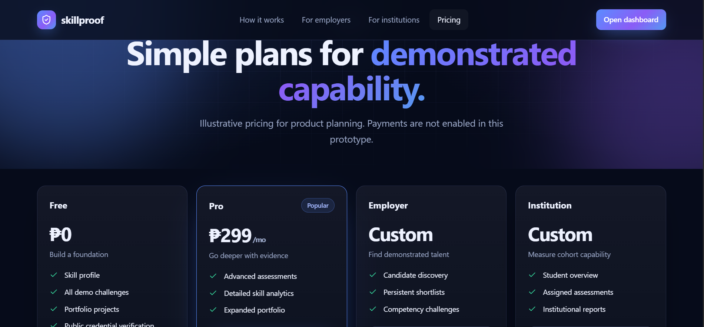

<div align="center">


<br/>


<br/>

**A skills verification and digital portfolio concept for the Philippines.**

<br/>


<br/><br/>

[Overview](#-overview) • [Features](#-key-features) • [How It Works](#-how-it-works) • [Screenshots](#-screenshots) • [Contributing](#-contributing)

</div>

---

<div align="center">


</div>

## 📌 Overview

**SkillProof PH** is a project concept focused on helping individuals showcase their skills, credentials, and achievements through a more organized and accessible digital platform.

It aims to bridge the gap between individuals who want to demonstrate their capabilities and organizations that need a better way to discover and assess talent.

Instead of relying only on traditional resumes, SkillProof PH envisions a platform where skills can be presented through structured profiles, supporting evidence, and verified credentials.

### 🎯 Our Goals

- Help individuals present their skills and achievements professionally.
- Make skill-related information easier for employers to assess.
- Support institutions in recognizing and showcasing the competencies of their learners.
- Encourage skills-based opportunities and professional development.
- Promote a more accessible and organized way of presenting talent in the Philippines.

---

## ✨ Key Features

| Feature | Description |
|---|---|
| **Digital Skill Profiles** | A centralized way to present personal skills, achievements, and credentials. |
| **Skill Verification Concept** | A framework for supporting skills with relevant evidence and credentials. |
| **Employer Access** | A proposed way for employers to discover and assess potential candidates. |
| **Institutional Support** | A concept for institutions to recognize and present the competencies of their learners. |
| **Platform Overview** | A visual explanation of the platform's purpose and workflow. |
| **Flexible Plans** | Proposed pricing options designed around different user needs. |

---

## 🔐 Trust, Verification & Privacy

SkillProof PH aims to establish a trustworthy environment where individuals can present their skills and credentials while allowing organizations to evaluate qualifications responsibly.

### Verification Principles

- **Evidence-Based Credentials:** Skills and qualifications should be supported by relevant documents, certificates, portfolios, or other forms of evidence.
- **Transparent Verification:** Verification status should clearly indicate whether a credential is pending, verified, rejected, or requires further review.
- **Source Accountability:** Whenever possible, credentials should be traceable to their issuing institutions or authorized organizations.
- **User Control:** Individuals should have control over the information they choose to include in their professional profiles.

### Privacy & Data Protection

- Protect personal information and sensitive documents.
- Limit access to credentials based on authorized permissions.
- Avoid exposing private user information without consent.
- Apply appropriate security measures when storing and handling personal data.

*These principles represent the project's intended direction and are not claims of currently implemented security or verification functionality.*

---

## ⚙️ How It Works

<div align="center">


<br/><br/>


</div>

The platform is designed around a simple process:

1. **Build a Profile** – Individuals organize their skills, qualifications, and achievements.
2. **Present Evidence** – Relevant credentials and supporting information help demonstrate their capabilities.
3. **Discover Opportunities** – Employers can explore potential candidates based on their skills.
4. **Recognize Competencies** – Institutions can support the presentation and recognition of learners' skills.

---

## 🖥️ Screenshots and Platform Preview

Explore the visual concept and proposed interface of SkillProof PH.

### Platform Overview

<div align="center">


<sub>Example of the SkillProof PH platform overview.</sub>

</div>

### For Employers

<div align="center">


<sub>A proposed view for employers.</sub>

</div>

### For Institutions

<div align="center">


<sub>A proposed view for educational institutions and organizations.</sub>

</div>

### Pricing

<div align="center">



<sub>Proposed pricing and platform plans.</sub>

</div>

---

## 👥 Who Is It For?

<div align="center">


</div>

- **Individuals:** People who want to present their skills, credentials, and accomplishments.
- **Employers:** Organizations looking for a more skills-oriented way to discover potential candidates.
- **Institutions:** Schools and organizations interested in recognizing and presenting the competencies of their learners.

---

## 📂 Repository Structure

```text
SkillProof-PH/
│
├── images/
│   ├── For employers.PNG
│   ├── For Institutions.PNG
│   ├── How it works #2.PNG
│   ├── How it works.PNG
│   ├── Overview example.PNG
│   └── Pricing.PNG
│
├── README.md
├── CONTRIBUTING.md
└── LICENSE
```

*The structure above reflects the documentation and visual assets included in this repository. Update it as the project source code and other components are added.*

---

## 🚀 Project Status

<details>
<summary><b>Current development direction</b></summary>

SkillProof PH is currently presented as a project concept and prototype. Its interface, features, and workflows are intended to communicate the platform's direction.

Further development may include:

- Functional user registration and authentication.
- Digital skill profile creation and management.
- Credential and evidence submission.
- Verification workflows.
- Employer and institutional dashboards.
- Search and discovery features.
- Subscription and payment integration.

These are potential development directions and should not be considered completed features unless implemented.

</details>

---

## 🤝 Contributing

Contributions, suggestions, and feedback are welcome!

If you are interested in helping improve SkillProof PH, you can:

- Report bugs or documentation issues.
- Suggest new features and improvements.
- Improve the user interface and user experience.
- Help refine the project concept.
- Contribute documentation and other resources.

Please read our **[CONTRIBUTING.md](CONTRIBUTING.md)** before submitting a contribution.

---

## 📄 License

This project is licensed under the **MIT License**. See the [LICENSE](LICENSE) file for details.

---

## 👨‍💻 Meet the Minds Behind SkillProof PH

<div align="center">


### 🚀 Driven by Ideas. Built Through Collaboration.

*Behind every great project is a team of people who turn ideas into reality.*

<br/>

<table>
  <tr>
    <td align="center" width="50%">
      <a href="https://github.com/rheillunio2-byte">
        
      </a>
      <br/><br/>
      <strong><a href="https://github.com/rheillunio2-byte">Rheil Evans Lunio</a></strong>
      <br/>
      <sub>👑 Project Lead & Lead Developer</sub>
      <br/><br/>
      
      <br/><br/>
      <sub>Vision, architecture, development, and project direction.</sub>
      <br/>
      <sub><b>RETL</b></sub>
    </td>
    <td align="center" width="50%">
      <a href="https://github.com/joshuaarao42-arch">
        
      </a>
      <br/><br/>
      <strong><a href="https://github.com/joshuaarao42-arch">Joshua Arao</a></strong>
      <br/>
      <sub>🤝 Co-Developer & Project Collaborator</sub>
      <br/><br/>
      
      <br/><br/>
      <sub>Shared ideas, technical contributions, and collaborative development.</sub>
    </td>
  </tr>
</table>

<br/>

### 💡 One Vision. Shared Innovation.

**SkillProof PH** is more than just a project. It is a collaborative effort to create meaningful opportunities by making skills more visible, credible, and accessible.

Every idea, contribution, and line of code brings us closer to that vision.

<br/>


**BUILT WITH PURPOSE. DEVELOPED TO MAKE A DIFFERENCE.** 

<sub>© 2026 SkillProof PH | Made with 💙 by the development team</sub>

</div>

<div align="center">


**SkillProof PH** · Show your skills. Build your proof.

<sub>© 2026 Rheil Evans Lunio. Licensed under the MIT License.</sub>

</div>

